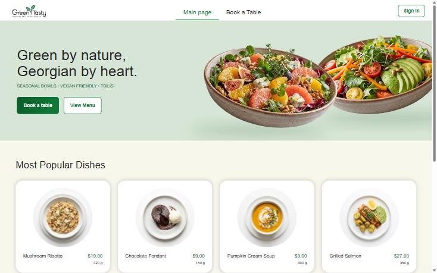
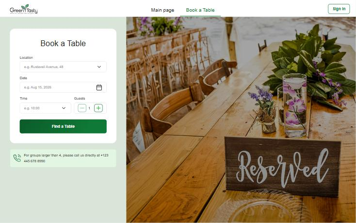
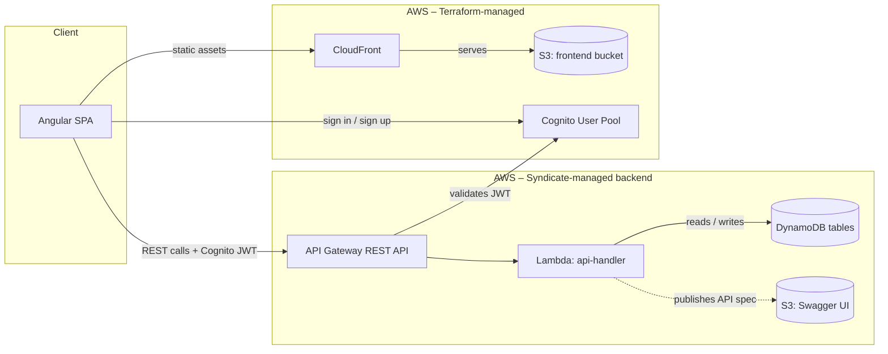

# Green & Tasty – Restaurant Booking & Pre-Order App

Full-stack restaurant table booking and pre-order application, built for **EPAM Campus IT Marathon 6.0**.
Customers book tables, pre-order dishes, and can split a reservation into a **group order** where each
guest builds their own cart before the table owner reviews and submits one consolidated pre-order to
the kitchen. Waiters get a dashboard to manage reservations, confirm or cancel individual dishes, and
mark service complete.

## Features

- **Table booking** – browse available tables by time slot, location and party size; create, edit, cancel reservations.
- **Pre-ordering** – add dishes to a reservation ahead of time, edit the cart up to a configurable cutoff before the reservation starts.
- **Group reservations** – the table owner invites guests via a shareable link; each guest gets their own cart and can submit it independently; the owner reviews everyone's picks, removes items if needed, and submits one consolidated order for the whole table.
- **Waiter dashboard** – manage assigned reservations, confirm/cancel pre-ordered dishes, edit table/time, generate post-visit reports.
- **Role-based access** – Customer and Waiter roles via AWS Cognito groups, enforced on both routes and business logic.
- **Security-hardened backend** – went through a structured vulnerability audit before this was made public (see [Security](#security) below).

## Screenshots

| Main page | Book a Table |
|---|---|
|  |  |

## Documentation

- [User Stories](docs/user-stories.md) – main features, written as Epic/Role/Description/AC.
- [Test Cases](docs/qa/test-cases.md) and [Defect Reports](docs/qa/defect-reports.md) – manual QA pass over the features above.
- [API docs (Swagger UI)](http://restaurant-backend-dev-swagger-ui-088976930222.s3-website.eu-north-1.amazonaws.com) – live, generated from the backend's own spec.

## Architecture



Frontend and auth/CDN infra are provisioned with Terraform; the API, Lambda and DynamoDB tables are deployed separately with AWS Syndicate from `backend/restaurant-backend-app`.

## Known Issues / Possible Improvements

- **Guest capacity is seat-based, not identity-based.** Joining a group pre-order only requires the invite link – there's no guest login, so the backend can enforce "no more than N joined guests" but can't tell whether two joins are the same physical person. Closing that gap would need guest accounts, which is out of scope for this project.
- **Dish availability ("Out of Stock") is set manually by staff**, not synced from a real inventory system.
- **The pre-order edit cutoff (30 minutes before the reservation) is a fixed constant**, not configurable per location or reservation.

## Tech stack

- **Frontend** – Angular 22 (standalone components, signals), SCSS
- **Backend** – .NET 10 on AWS Lambda, DynamoDB, API Gateway (REST), AWS Cognito
- **Infrastructure** – Terraform (shared AWS infra: CloudFront, Cognito, S3, EventBridge) + AWS Syndicate (serverless backend deploy)

## Security

Before making this repository public, the backend went through a structured audit (manual review +
automated scan) and every Critical finding, plus every High/Medium finding that an ordinary user could
trigger through normal use (not only a deliberate attacker), was fixed. Summary by category:

### Authorization / IDOR
- Several staff-management and catalog-write endpoints (`POST /waiters`, `DELETE /waiters`,
  `POST /locations`, `POST /tables`, `POST /dishes`) had no authorizer at all – anyone could grant
  themselves the Waiter role or tamper with the menu/tables. Now require Cognito auth + a Waiter-role
  check in the handler.
- `GET /reservations/{id}` and the group-order invite-token endpoint returned another customer's
  reservation/order data to any authenticated user who knew or guessed the ID (classic IDOR). Both now
  verify the caller is the reservation's owner or its assigned waiter.

### Race conditions
- Joining a group reservation used a read-then-write check against the guest limit, so two guests
  joining at nearly the same moment could both slip past the limit. Replaced with an atomic conditional
  `UpdateItem` in DynamoDB instead of a plain application-level check.
- Table-overlap checks were including cancelled/completed reservations as if they still occupied the
  table, which could incorrectly block a legitimately free slot.

### Business-logic consistency
- A handful of status-transition guards (e.g. blocking edits to an already-cancelled reservation, or
  rejecting a no-op status update) built an error response but never actually returned it – the checks
  existed in the code but never fired.
- The pre-order edit cutoff (changes locked 30 minutes before a reservation starts) was enforced
  inconsistently: the table owner's path checked it, but a guest in a group order, or submitting/cancelling
  a pre-order directly, did not. All pre-order write paths now share the same cutoff rule.

### Secrets hygiene
- A local Syndicate CLI config directory (holding a real AWS account ID) was being tracked by git due to
  a `.gitignore` pattern that didn't match the actual folder name – fixed, and any real account IDs in
  tracked files were replaced with placeholders before the first push.

These findings were part of normal iteration during a time-boxed workshop, not something discovered
after the fact in a live/exploited system – every item above was fixed before this repo went public.

## Repository layout

```
frontend/restaurant-frontend-app/   Angular SPA
backend/restaurant-backend-app/     .NET Lambda backend (API + handlers + services)
infra/terraform/                    Shared AWS infrastructure (IaC)
infra/dev-seed/                     Local dev data seeding scripts
```

---

# Deployment Guide

This repo uses three deployment tracks:

- Terraform for shared AWS infrastructure under `infra/terraform`
- AWS Syndicate for the backend application under `backend/restaurant-backend-app`
- Angular build artifacts synced to the frontend S3 bucket under `frontend/restaurant-frontend-app`

## Prerequisites

Install the tools below on your machine:

- AWS CLI configured with credentials for the target AWS account (`aws configure`) (https://docs.aws.amazon.com/cli/latest/userguide/getting-started-prereqs.html)
- Terraform 1.10 or newer (https://developer.hashicorp.com/terraform/install)
- Python 3.10-3.11 (https://www.python.org/downloads/release/python-3110/)
- .NET 10 SDK (https://dotnet.microsoft.com/en-us/download/dotnet/10.0)
- AWS Syndicate (`pip install aws-syndicate`) (https://github.com/epam/aws-syndicate)
- Node.js 22.x with npm (https://nodejs.org/en/download/archive/v22.0.0)

## Deployment order

Use this order:

1. Deploy Terraform infrastructure
2. Deploy the backend using Syndicate
3. Deploy the frontend to s3

Terraform then provisions or updates the shared AWS foundation, including the frontend S3 bucket and CloudFront distribution. Syndicate packages and deploys the backend application stack. After that, build the Angular app with the correct backend URL and sync it to S3.

## 1. Deploy Terraform infrastructure

Terraform manages the shared infrastructure resources in `infra/terraform`.

Before deploying, verify terraform config files:
Replace variables with your **AWS account ID** and **Email**

- `infra/terraform/backend.tf` - replace the Terraform state bucket name
- `infra/terraform/variables.tf` - replace the default `account_id` and `alert_emails`


Before running `terraform init`, create the Terraform state bucket with AWS CLI if it does not already exist. 
Get your AWS account ID from the CLI first:

Windows PowerShell:

```powershell
$ACCOUNT_ID = aws sts get-caller-identity --query Account --output text
```

Linux or macOS:

```bash
ACCOUNT_ID=$(aws sts get-caller-identity --query Account --output text)
```

You can use AWS Console interface
AWS Management Console equivalent:
- Go to **S3** → **Create bucket** and use the bucket name **restaurant-terraform-state-$ACCOUNT_ID**
- Turn on **Versioning** in the bucket properties
- Leave **Block all public access** enabled
- Use **Default encryption** with SSE-S3 (AES256)

As alternative you can you AWS CLI
Replace the bucket name with the CLI variable:

Windows PowerShell:

```powershell
aws s3api create-bucket `
	--bucket restaurant-terraform-state-$ACCOUNT_ID `
	--region eu-north-1 `
	--create-bucket-configuration LocationConstraint=eu-north-1

aws s3api put-bucket-versioning `
	--bucket restaurant-terraform-state-$ACCOUNT_ID `
	--versioning-configuration Status=Enabled

aws s3api put-public-access-block `
		--bucket restaurant-terraform-state-$ACCOUNT_ID `
	--public-access-block-configuration `
		"BlockPublicAcls=true,IgnorePublicAcls=true,BlockPublicPolicy=true,RestrictPublicBuckets=true"
```

Linux or macOS:

```bash
aws s3api create-bucket \
	--bucket restaurant-terraform-state-$ACCOUNT_ID \
	--region eu-north-1 \
	--create-bucket-configuration LocationConstraint=eu-north-1

aws s3api put-bucket-versioning \
	--bucket restaurant-terraform-state-$ACCOUNT_ID \
	--versioning-configuration Status=Enabled

aws s3api put-public-access-block \
		--bucket restaurant-terraform-state-$ACCOUNT_ID \
	--public-access-block-configuration \
		"BlockPublicAcls=true,IgnorePublicAcls=true,BlockPublicPolicy=true,RestrictPublicBuckets=true"
```

### After bucket creation
```bash
cd ../../infra/terraform
terraform init
terraform fmt -check -recursive
terraform validate
terraform plan
terraform apply -auto-approve
```

## 2. Deploy the backend with Syndicate

The backend app is deployed from `backend/restaurant-backend-app`.

Before deploying, verify the Syndicate config files:
edit syndicate.yml → set project_path to your local absolute path to backend/restaurant-backend-app
Replace bucket names with your AWS account ID
- `.syndicate-config-restaurant-backend-app/syndicate.yml`
- `.syndicate-config-restaurant-backend-app/syndicate_aliases.yml`

On Windows PowerShell, run:

```powershell
cd ../../backend/restaurant-backend-app
python3 -m venv syndicate_venv
.\syndicate_venv\Scripts\Activate.ps1
pip install aws-syndicate
$env:SDCT_CONF = (Resolve-Path ".\.syndicate-config-restaurant-backend-app").Path
syndicate create-deploy-target-bucket
syndicate build
syndicate deploy --deploy_name dev
```

On Linux or macOS, run:

```bash
cd ../../backend/restaurant-backend-app
python3 -m venv syndicate_venv
source syndicate_venv/bin/activate
export SDCT_CONF="$(pwd)/.syndicate-config-restaurant-backend-app"
syndicate create-deploy-target-bucket
syndicate build
syndicate deploy --deploy_name dev
```

For an incremental update instead of a full deploy, run the matching command for your shell.

```
syndicate update
```

## 3. Deploy the frontend

This section describes the manual deployment flow. It does not use GitHub Actions.

Terraform creates and configures everything needed for frontend hosting:

- the private frontend S3 bucket
- the bucket policy that allows CloudFront to read from it
- the CloudFront distribution that serves the site

You do not need to configure the bucket manually after `terraform apply`. The manual part is only building the frontend and uploading the files to S3.

### 3.1 Get the backend URL

Use the deployed API Gateway base URL as `BACKEND_URL`. Example:

```text
https://<api-id>.execute-api.eu-north-1.amazonaws.com/develop
```

The production frontend build will fail unless `BACKEND_URL` is set.

To look it up in AWS:

```powershell
aws apigateway get-rest-apis --region eu-north-1 --query "items[?name=='restaurant-backend-api'].{name:name,id:id}" --output table
```

Or set variables from AWS CLI:

Windows PowerShell:

```powershell
$API_ID = aws apigateway get-rest-apis --region eu-north-1 --query "items[?name=='restaurant-backend-api'].id | [0]" --output text
$env:BACKEND_URL = "https://$API_ID.execute-api.eu-north-1.amazonaws.com/develop"
```

Linux or macOS:

```bash
API_ID=$(aws apigateway get-rest-apis --region eu-north-1 --query "items[?name=='restaurant-backend-api'].id | [0]" --output text)
export BACKEND_URL="https://$API_ID.execute-api.eu-north-1.amazonaws.com/develop"
```

### 3.2 Build the production bundle

From the frontend app directory, install dependencies and build:

```powershell
cd ../../frontend/restaurant-frontend-app
npm ci
npm run build
```

The build process generates `src/environments/environment.production.ts` automatically from `BACKEND_URL` and writes the production bundle to `dist/restaurant-frontend-app/browser`.

### 3.3 Upload the bundle to S3

Sync the built files to the frontend bucket:

```powershell
aws s3 sync dist/restaurant-frontend-app/browser s3://restaurant-frontend-$ACCOUNT_ID/ --delete
```

The `--delete` flag removes files in S3 that no longer exist in the local build output.

### 3.4 Get the frontend URL

Get the CloudFront domain name from Terraform:

```powershell
cd ../../infra/terraform
terraform output cloudfront_distribution_domain_name
terraform output cloudfront_distribution_id
```

Use the returned domain name as the frontend host. Example:

```text
https://dxxxxxxxxxxxx.cloudfront.net
```

CloudFront does not provide a fixed public IP you should use. Use the distribution domain name instead.

## Clean up all resources

Use the reverse order of deployment:

1. Remove uploaded frontend files from the frontend S3 bucket
2. Clean up the backend resources deployed by Syndicate
3. Destroy the shared infrastructure managed by Terraform
4. Remove the Terraform state bucket
5. Remove the Syndicate artifacts bucket

### Remove frontend files from S3

The frontend bucket must be empty before Terraform can destroy it.

```powershell
aws s3 rm s3://restaurant-frontend-$ACCOUNT_ID/ --recursive
```

If you are not using the shared training account, replace the bucket name with your own account-specific frontend bucket.

### Clean up backend resources with Syndicate

From the backend project directory, use the same Syndicate configuration and run:

```powershell
cd ../../backend/restaurant-backend-app
$env:SDCT_CONF = (Resolve-Path ".\.syndicate-config-restaurant-backend-app").Path
syndicate clean
```

On Linux or macOS, use:

```bash
cd ../../backend/restaurant-backend-app
export SDCT_CONF="$(pwd)/.syndicate-config-restaurant-backend-app"
syndicate clean
```

This removes the backend resources that Syndicate deployed into the AWS account.

### Destroy Terraform-managed infrastructure

After the frontend bucket is empty and the backend resources are removed, destroy the shared infrastructure:

```powershell
cd ../../infra/terraform
terraform destroy -auto-approve
```

This removes the frontend S3 bucket, CloudFront distribution, and the rest of the infrastructure managed in `infra/terraform`.

### Clear versioned bucket

S3 bucket for storing terraform state have versioning configured. In order to delete it you must empty all versions created for s3 object.

- Go to **S3** select **restaurant-terraform-state-$ACCOUNT_ID** → **Empty Bucket**

### Remove the Terraform state bucket

The Terraform state bucket is configured in `infra/terraform/backend.tf` and is not deleted by `terraform destroy`. Empty it first and then delete it manually:

```powershell
aws s3api delete-bucket --bucket restaurant-terraform-state-$ACCOUNT_ID --region eu-north-1
```

### Remove the Syndicate artifacts bucket

The Syndicate deploy target bucket is not managed by Terraform in this repo. If you also want to delete that bucket, empty it first and then remove it manually:

```powershell
aws s3 rm s3://marathon2026-restaurant-artifacts-$ACCOUNT_ID/ --recursive
aws s3api delete-bucket --bucket marathon2026-restaurant-artifacts-$ACCOUNT_ID --region eu-north-1
```

Only do this if you are sure you no longer need the stored Syndicate build artifacts.