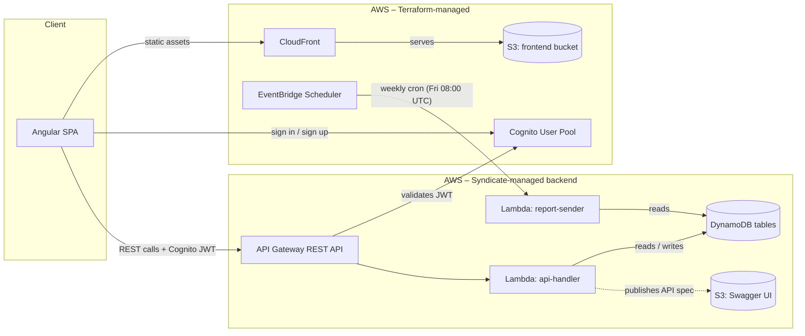

# Green & Tasty – Restaurant Booking & Pre-Order App

[](https://github.com/nyxelline/green-tasty-restaurant/actions/workflows/ci.yml)
[](https://github.com/nyxelline/green-tasty-restaurant/actions/workflows/aqa.yml)
[](frontend/restaurant-frontend-app)
[](backend/restaurant-backend-app)
[](LICENSE)
[](#security)

Full-stack restaurant table booking and pre-order application, built for **EPAM Campus IT Marathon 6.0**.
Customers book tables, pre-order dishes, and can split a reservation into a **group order** where each
guest builds their own cart before the table owner reviews and submits one consolidated pre-order to
the kitchen. Waiters get a dashboard to manage reservations, confirm or cancel individual dishes, and
mark service complete.

## Features

- **Table booking** – browse available tables by time slot, location and party size; create, edit, cancel reservations.
- **Pre-ordering** – add dishes to a reservation ahead of time, edit the cart up to a configurable cutoff before the reservation starts.
- **Group reservations** – the table owner invites guests via a shareable link; each guest gets their own cart and can submit it independently; the owner reviews everyone's picks, removes items if needed, and submits one consolidated order for the whole table.
- **Waiter dashboard** – manage assigned reservations, confirm/cancel pre-ordered dishes, edit table/time, generate post-visit reports.
- **Role-based access** – Customer and Waiter roles via AWS Cognito groups, enforced on both routes and business logic.
- **Security-hardened backend** – went through a structured vulnerability audit before this was made public (see [Security](#security) below).

## Screenshots

| Main page | Book a Table |
|---|---|
|  |  |

*Waiter dashboard and group pre-order screens aren't captured yet — see [Known Issues](#known-issues--possible-improvements).*

## Documentation

- [User Stories](docs/user-stories.md) – main features, written as Epic/Role/Description/AC.
- [Test Cases](docs/qa/test-cases.md) and [Defect Reports](docs/qa/defect-reports.md) – manual QA pass over the features above.
- [AQA automated tests](aqa/README.md) – API + UI test automation (.NET/NUnit/Playwright) for the group pre-order feature; runs in CI on every push/PR (`.github/workflows/aqa.yml`).
- **API docs (Swagger UI)** – live, generated from the backend's own spec. Single version, no changelog yet — the Swagger spec always reflects whatever is currently deployed. The URL includes this project's AWS account ID, so it isn't printed here directly; get it with:
  ```bash
  ACCOUNT_ID=$(aws sts get-caller-identity --query Account --output text)
  echo "http://restaurant-backend-dev-swagger-ui-$ACCOUNT_ID.s3-website.eu-north-1.amazonaws.com"
  ```
  (needs AWS CLI credentials for this project's account; without them, ask the maintainer for the link).
- [Deployment Guide](docs/deployment.md) – full from-scratch AWS deployment (Terraform + Syndicate + S3/CloudFront). Not needed just to run the frontend locally, see below.
- [Working notes](docs/notes/) – the original homework task spec (`homework-backend.md`) and internal Angular Signals conventions (`signals-migration.md`), kept for reference.

## Local Development

### Frontend only (no AWS account needed)

`npm start` already points at the live deployed backend (`src/environments/environment.development.ts`), so this works with nothing else set up:

```bash
cd frontend/restaurant-frontend-app
npm ci
npm start
```

Open `http://localhost:4200`. You're hitting the real deployed API/Cognito/DynamoDB, so sign-up, booking, pre-ordering, group orders — everything works, same as the live site.

### Backend

There's no local-only backend run (no docker-compose, no local DynamoDB) — the Lambda handlers and DynamoDB tables in this project only exist once deployed to AWS via Syndicate/Terraform. To change backend code and see it live, deploy your own stack: see the [Deployment Guide](docs/deployment.md).

`infra/dev-seed/seed_dev_data.py` reseeds demo data (one location, 6 tables, 10 dishes) into an already-**deployed** backend — it's not a local seeding script, it still talks to real AWS via `boto3`. See the script's own docstring for usage.

### Running the automated tests

The AQA suite in `aqa/` (`dotnet test`) also runs against the deployed environment by default — see [`aqa/README.md`](aqa/README.md) for setup and filters (`--filter "Category=Api"` / `"Category=Ui"`).

## Architecture



Frontend and auth/CDN infra are provisioned with Terraform; the API, Lambda and DynamoDB tables are deployed separately with AWS Syndicate from `backend/restaurant-backend-app`. **EventBridge Scheduler** triggers the `report-sender` Lambda every Friday to generate weekly waiter reports; **`alert_emails`** (a Terraform variable) subscribes addresses to CloudWatch alarms and AWS Budget notifications for the account, unrelated to the weekly-reports schedule.

### Data model (DynamoDB)

| Table | Partition key | Sort key | GSIs |
|---|---|---|---|
| `Reservations` | `id` | – | by `tableId`, `waiterId`, `customerId` |
| `Tables` | `id` | – | by `locationId` |
| `Dishes` | `id` | – | – |
| `Locations` | `id` | – | – |
| `Orders` | `orderId` | `customerId` | by `customerId`, `reservationId` |
| `Waiters` | `userId` | – | by `locationId` |
| `GroupReservations` | `groupReservationId` | – | by `reservationToken`, `reservationId` |
| `GuestSessions` | `guestSessionId` | – | by `groupReservationId`, `guestSessionTokenHash` |
| `Notifications` | `id` | – | by `userId` |
| `Reports` | `waiterId` | `date` | – |
| `ReportsHistory` | `id` | – | by `userId` |
| `ProfileImages` | `userId` | – | – |
| Feedback (`${feedback_table_name}`) | `reservationId` | `createdAt` | by `locationId` |

All tables are `PAY_PER_REQUEST`. Exact attribute shapes live in each table's `Entities/*.cs` class in `backend/restaurant-backend-app`.

## Known Issues / Possible Improvements

- **Guest capacity is seat-based, not identity-based.** Joining a group pre-order only requires the invite link – there's no guest login, so the backend can enforce "no more than N joined guests" but can't tell whether two joins are the same physical person. Closing that gap would need guest accounts, which is out of scope for this project.
- **Dish availability ("Out of Stock") is set manually by staff**, not synced from a real inventory system.
- **The pre-order edit cutoff (30 minutes before the reservation) is a fixed constant**, not configurable per location or reservation.
- **No local-only backend run** (no docker-compose / local DynamoDB) – backend code can only be exercised once deployed to AWS; see [Local Development](#local-development).
- **Screenshots only cover two pages** – the waiter dashboard and group pre-order flow aren't captured yet.
- **No API versioning/changelog** – the Swagger UI always reflects whatever is currently deployed; there's no way to see what changed between deploys.
- **No AWS WAF / rate limiting in front of API Gateway or CloudFront.** The public unauthenticated endpoints (reservation creation, group-order invite links) have no request-rate protection beyond API Gateway's account-level default throttling – a dedicated WAF with rate-based rules would be the next step if this went past a student project.

## Tech stack

- **Frontend** – Angular 22 (standalone components, signals), SCSS
- **Backend** – .NET 10 on AWS Lambda, DynamoDB, API Gateway (REST), AWS Cognito
- **Infrastructure** – Terraform (shared AWS infra: CloudFront, Cognito, S3, EventBridge) + AWS Syndicate (serverless backend deploy)
- **Testing** – manual QA pass (`docs/qa/`) + automated API/UI tests in `aqa/` (.NET, NUnit, Playwright), run in CI via GitHub Actions

## Security

Before making this repository public, the backend went through a structured audit (manual review +
automated scan) and every Critical finding, plus every High/Medium finding that an ordinary user could
trigger through normal use (not only a deliberate attacker), was fixed. Summary by category:

### Authorization / IDOR
- Several staff-management and catalog-write endpoints (`POST /waiters`, `DELETE /waiters`,
  `POST /locations`, `POST /tables`, `POST /dishes`) had no authorizer at all – anyone could grant
  themselves the Waiter role or tamper with the menu/tables. Now require Cognito auth + a Waiter-role
  check in the handler.
- `GET /reservations/{id}` and the group-order invite-token endpoint returned another customer's
  reservation/order data to any authenticated user who knew or guessed the ID (classic IDOR). Both now
  verify the caller is the reservation's owner or its assigned waiter.

### Race conditions
- Joining a group reservation used a read-then-write check against the guest limit, so two guests
  joining at nearly the same moment could both slip past the limit. Replaced with an atomic conditional
  `UpdateItem` in DynamoDB instead of a plain application-level check.
- Table-overlap checks were including cancelled/completed reservations as if they still occupied the
  table, which could incorrectly block a legitimately free slot.

### Business-logic consistency
- A handful of status-transition guards (e.g. blocking edits to an already-cancelled reservation, or
  rejecting a no-op status update) built an error response but never actually returned it – the checks
  existed in the code but never fired.
- The pre-order edit cutoff (changes locked 30 minutes before a reservation starts) was enforced
  inconsistently: the table owner's path checked it, but a guest in a group order, or submitting/cancelling
  a pre-order directly, did not. All pre-order write paths now share the same cutoff rule.

### Secrets hygiene
- A local Syndicate CLI config directory (holding a real AWS account ID) was being tracked by git due to
  a `.gitignore` pattern that didn't match the actual folder name – fixed (it's untracked and gitignored
  now; verified with `git ls-files` / `git check-ignore`).
- This project's real AWS account ID doesn't appear anywhere in this repo as a literal value anymore —
  the one direct link that used to include it (Swagger UI, above) now shows the command to derive it
  instead. No actual secrets (credentials, access keys, tokens) appear anywhere in this repository.

These findings were part of normal iteration during a time-boxed workshop, not something discovered
after the fact in a live/exploited system – every item above was fixed before this repo went public.

## Repository layout

```
frontend/restaurant-frontend-app/   Angular SPA
backend/restaurant-backend-app/     .NET Lambda backend (API + handlers + services)
infra/terraform/                    Shared AWS infrastructure (IaC)
infra/dev-seed/                     Demo-data seeding script (targets the deployed backend)
aqa/                                 Automated API/UI tests (.NET, NUnit, Playwright)
docs/                                User stories, QA pass, deployment guide, screenshots, working notes
```

## License

[MIT](LICENSE) – a student project made public for portfolio/review purposes.

